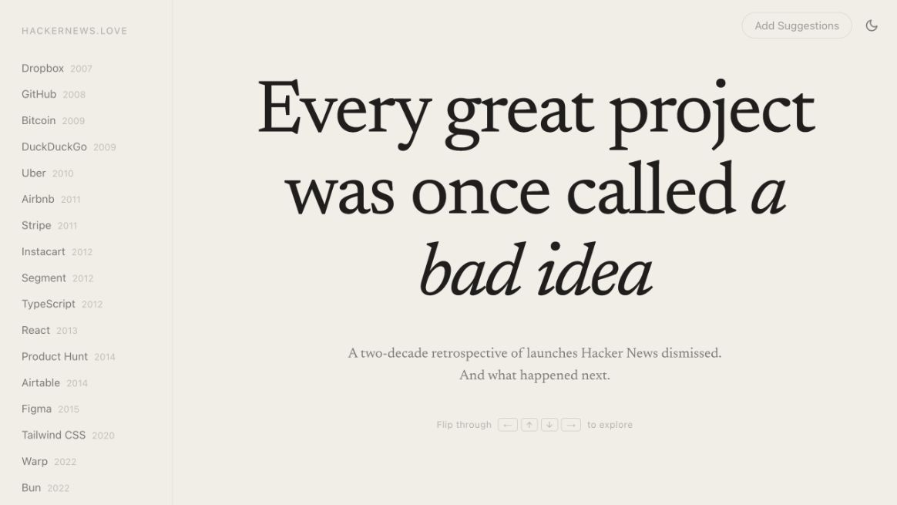
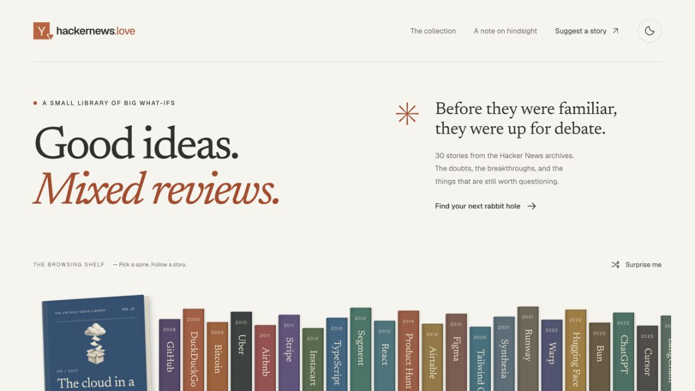
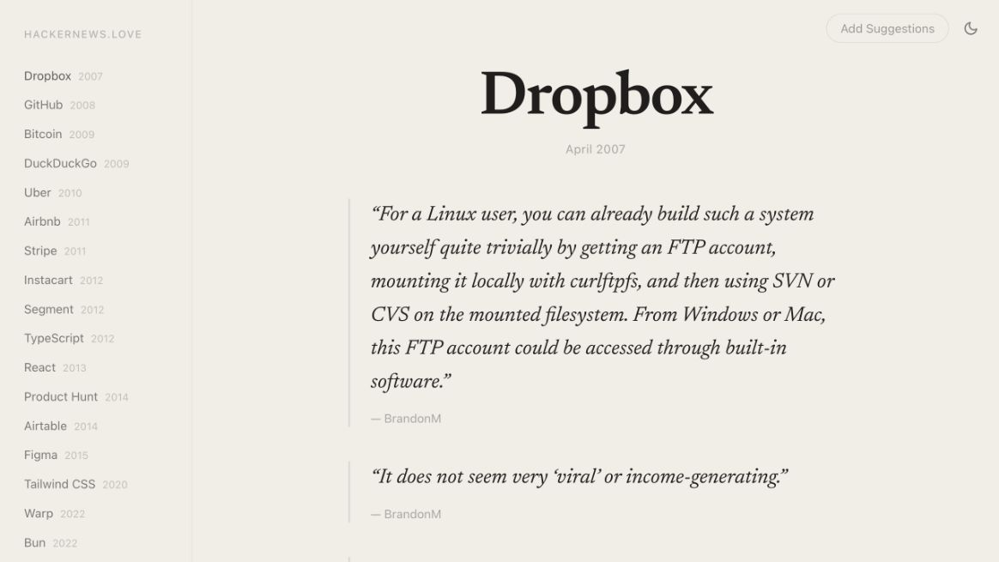
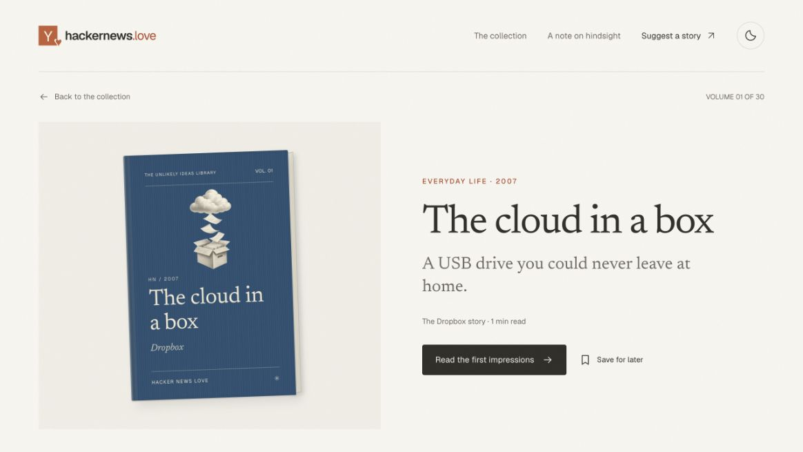
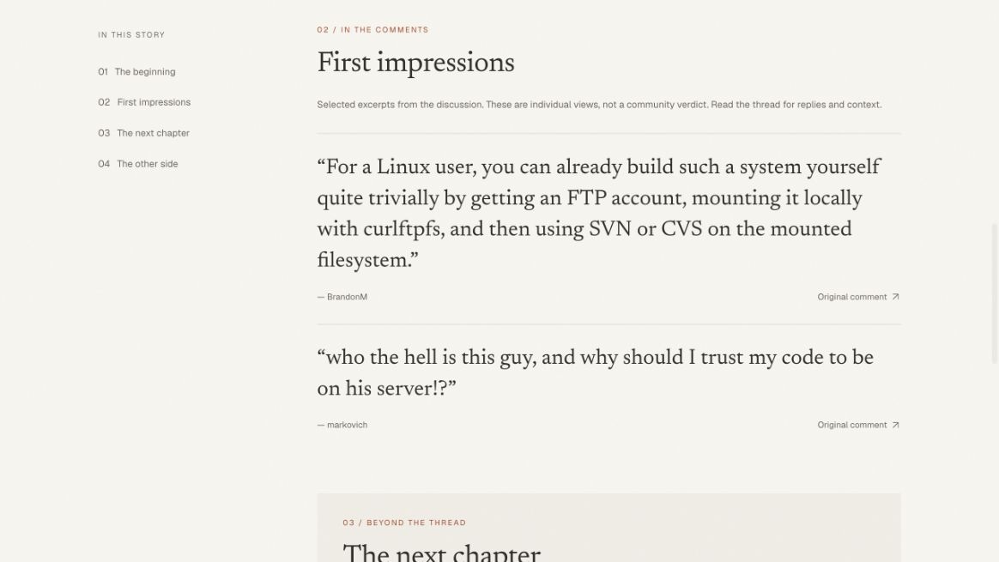

# Before and after

Captured November 6, 2026, from local production builds in the built-in Codex browser. All five images use the same 1164 × 655 viewport and light theme. Images are unedited browser captures.

- **Before:** `51b1086`, the version immediately before the redesign.
- **After:** `0d76f52`, the redesign in PR #2 with eight additional researched stories. Untracked research notes are excluded.

## Home

The original offers a company sidebar and a full-height introduction. The redesign introduces the browsing shelf, with a searchable collection below it.

| Before | After |
| --- | --- |
|  |  |

## Opening a Dropbox story

The original sidebar jumps directly to the quotes. The redesign opens a dedicated reading page with a cover, save control, and a link to the first impressions. The cover adds an introductory step; the screenshots show that trade-off.

| Before | After |
| --- | --- |
|  |  |

The first-impressions link jumps to excerpts with direct comment links. The story continues to a sourced milestone and a separate discussion of valid criticism.

## Reproduction

Both versions run from temporary Git source snapshots, with the repository's installed dependencies linked in. Production builds use `bun run build --webpack`, because Turbopack rejects dependency symlinks outside a snapshot's root. This does not change the application source.

The after snapshot also runs the repository's browser suite against its production server. These captures establish appearance and navigation, not a measured improvement in engagement or reading speed.
