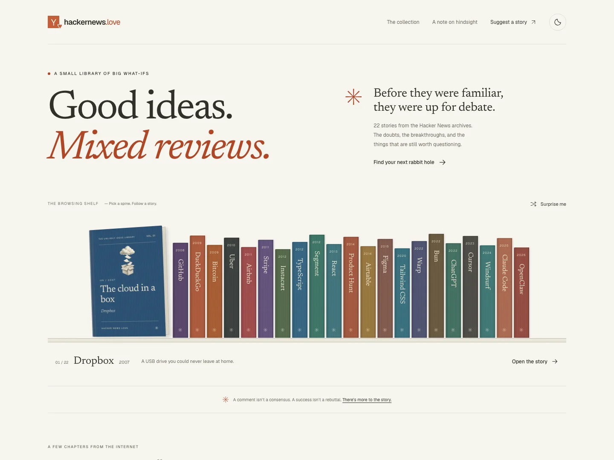
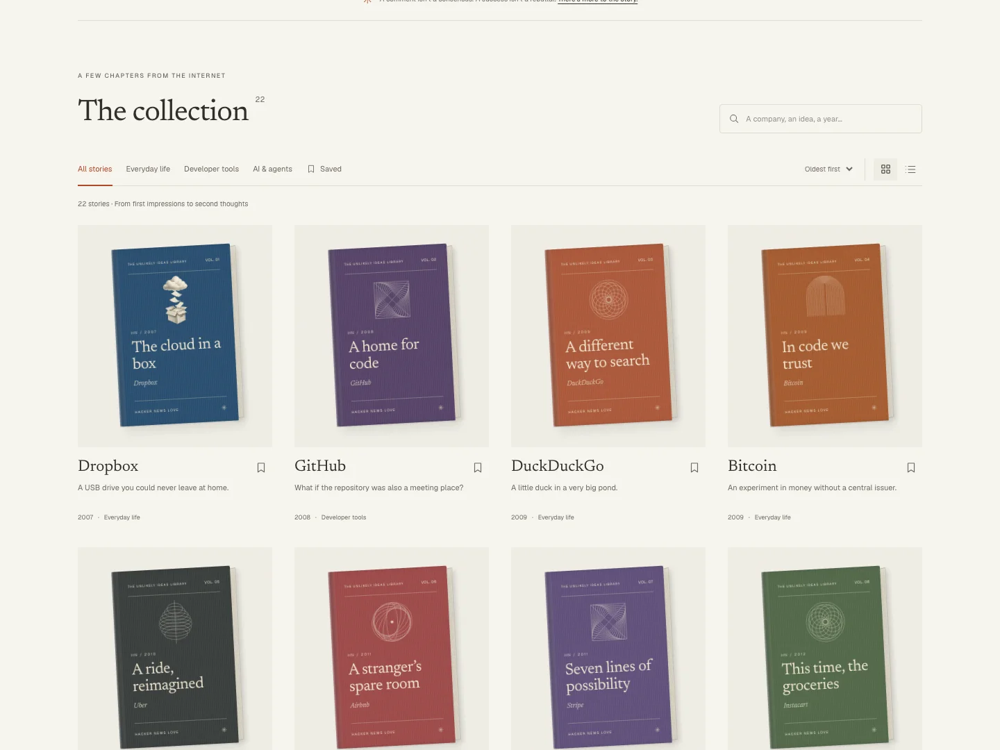
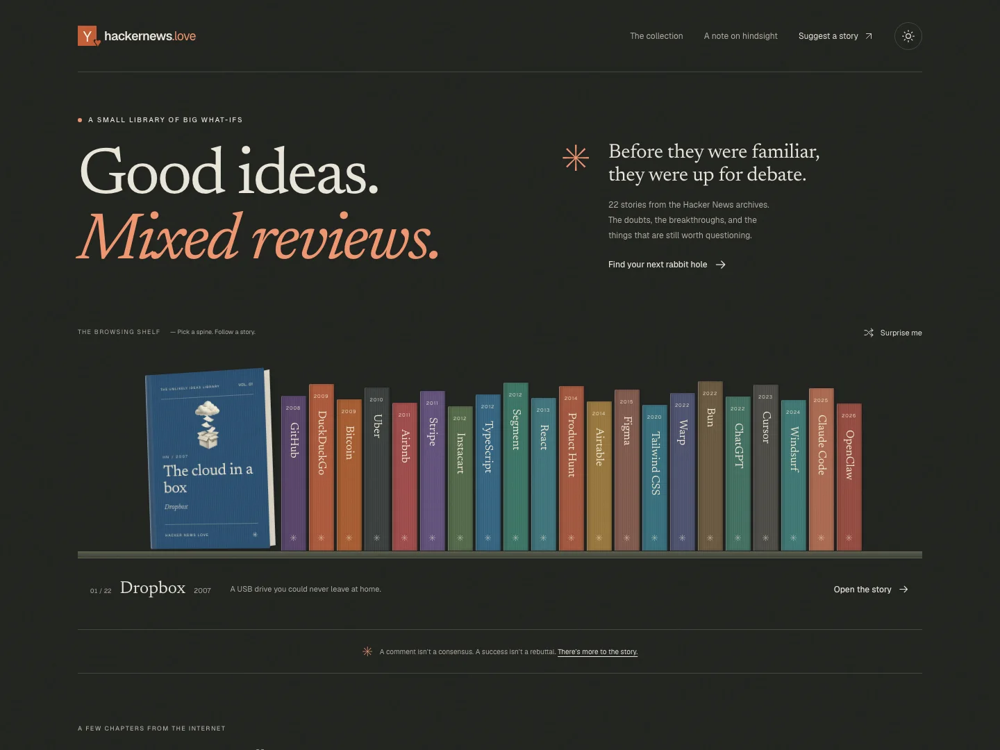

# A library worth browsing

## Problem and success conditions

The [visitor discussion](https://news.ycombinator.com/item?id=47120188) identified forced scrolling, accidental external navigation, selective quotation presented as consensus, and outcomes that dismissed valid concerns. The previous interface also made readers traverse full-screen sections with little overview.

Readers should be able to:

- Browse at their own pace, position text freely, and use ordinary browser navigation.
- Find a project or topic, preview a story, save it, and continue reading.
- Read comfortably on a narrow phone, with a keyboard, with reduced motion, or without JavaScript.
- Inspect the original comment and a dated source for the later milestone.
- Understand that adoption does not settle every criticism.

## Direction and alternatives

Both supplied videos use physical books as an invitation to explore. The audience is curious HN readers and builders looking for perspective; the tone is warm, playful, and editorial.

A WebGL gallery could support free camera movement and elaborate lighting. It would add rendering overhead, accessibility work, and a second interaction model. CSS book covers provide the useful depth, paper edges, cloth texture, and hover feedback while remaining ordinary links and buttons. We chose CSS with one generated engraving and geometric cover ornaments.

A single scrolling document keeps everything together but makes long collections harder to navigate. A library plus static story pages gives each story a permanent URL, a short reading journey, and metadata. Native document scrolling and browser Back remain available.

```text
Verified story data
  ├─ Home: shelf → preview → story
  │        collection → search / topic / sort / reading list
  ├─ Static story: beginning → comments → milestone → context
  └─ Sitemap and page metadata
```

Search, category, view, and sort are URL state. Saving uses browser storage with an in-memory fallback. The site needs no accounts or backend for these features.

## Motion audit and implementation

| Location | Reviewed gap | Purpose | Frequency | Recipe |
| --- | --- | --- | --- | --- |
| `components/bookshelf.tsx` | Selected book needs a visual connection to its spine | Spatial consistency | Occasional selection | CSS `@starting-style`, opacity .4 to 1 and transform from `rotateY(-25deg) rotateZ(-2deg) translateY(-3%)` to the settled cover, 200ms `cubic-bezier(0.23,1,0.32,1)`; pointer selection only |
| `components/book.tsx` | Cover needs a small affordance for opening | Feedback | Tens per day | Transform from `rotateY(-14deg) rotateZ(-3deg)` to `rotateY(-5deg) rotateZ(-1deg) translateY(-3px)`, 200ms with the shared ease-out; fine-pointer hover only |
| `components/save-button.tsx` | Press needs immediate acknowledgement | Feedback | Tens per day | CSS press scale .97, 160ms shared ease-out; state changes immediately |

Rejected candidates:

- Keyboard navigation: high-frequency, keyboard-initiated. No animated scrolling or interception of arrow keys.
- Search/filter results: functional content. No stagger, exit delay, or moving text.
- Reading-page quotes: functional content. No scroll reveals or parallax.
- Background ornaments: no persistent animation; their purpose is visual identity.

Reduced motion removes interaction movement and retains a short opacity affordance. No motion library is installed. Keyboard book selection is immediate. The shelf only adjusts its own horizontal position to reveal a selection; it does not change the document's vertical scroll position.

## Editorial repair

All 22 stories remain. The collection now uses 44 short excerpts with direct comment permalinks. Their text, authors, discussion titles, and dates are verified against live HN records. Two source threads were wrong: Instacart linked to a comment on Virool; Tailwind linked to a comment rather than its root discussion. Several months were also incorrect.

We removed edited or weak excerpts and quotations about a different subject. In particular, Claude subscription comments in the Sonnet launch thread do not establish experience with the newly launched Claude Code. One inherited quote was itself quoted by another commenter; it is not attributed to the replier.

The Dropbox story links to dang's explanation of the often-misread comment. Tailwind acknowledges the commenter's later edit. Outcomes link to primary sources, use dated milestones, and omit unsupported superlatives. Each story includes a separate discussion of valid criticism and evidential limits.

The source audit verifies text and attribution, not the representativeness of a selection or the truth of company claims. This remains a curated collection with survivorship bias.

## Verification

See `tests/e2e/library.spec.ts` for the executable checks. It covers the collection, shelf, reading list, browser Back, all 22 story routes, keyboard behavior, reduced motion, storage failure, 320px reflow, automated WCAG AA checks, missing routes, metadata, assets, and reading without JavaScript. Projects include desktop Chromium, mobile Chromium, and mobile WebKit.

`bun run verify:quotes` checks live quote text, authors, thread titles, and dates. Outcome links are reviewed separately because external sites may block automated requests or redirect by region. Undated sources show their review month rather than implying an event date.

Test results and screenshots are generated under ignored `test-results/` and `playwright-report/` directories. Automated accessibility results do not replace a screen-reader or physical-device audit. No production deployment is implied by a passing local build.

### Results — September 26, 2026

- `bun run check`: lint, TypeScript, and production build passed. All 22 story pages were prerendered.
- `bun run test:e2e`: 36 tests passed in 14.8 seconds against the production build. Each of the three browser projects visits every story; no uncaught page errors occurred on those routes.
- Axe checks found no WCAG 2 A/AA or 2.1 A/AA violations on the home and Dropbox pages, in both themes, across all three browser projects.
- `bun run verify:quotes`: 44 excerpts verified against 22 live discussions.
- Visual review covered desktop, mobile, light, and dark pages. Cover-title bounds were checked at widths of 320, 390, 768, 1024, and 1440 pixels without overlap or overflow.
- The initial checks caught insufficient contrast and a four-pixel overflow at 320 pixels. Both were corrected before the passing run.

These are local production-build results, not a public deployment test. Device profiles emulate phones; no physical-device or screen-reader test was performed. External source pages were reviewed, but they remain outside this application's control.

## Review screenshots







[Phone home](screenshots/home-mobile.webp) · [Phone collection](screenshots/collection-mobile.webp) · [Desktop story](screenshots/story-desktop.webp) · [Phone story](screenshots/story-mobile.webp)
